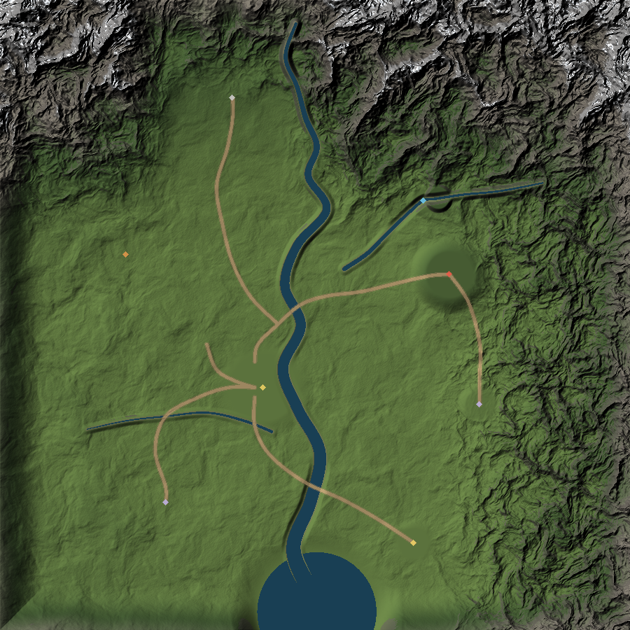

# BEYOND THE HORIZON: FINDING PEACE

A playable, streamed historical open-world benchmark built with **Godot 4.7 (Forward+)**.
This repository is the game project itself, not a design document: it contains a real
terrain field, river network, forests, a village, a castle, roads, bridges, a third-person
explorer and free CC0 assets integrated into the project.



*The image above is a shaded-relief render computed from the same `TerrainField.height()`
the game uses (`tools/export_world_map.gd`). It is a data visualisation, not an in-engine
screenshot - see the verification notes below.*

## What is actually implemented

| Area | State |
|---|---|
| Godot project (Forward+, 4.7, Jolt) | Playable project, `scenes/main.tscn` |
| 2 048 m x 2 048 m terrain, 128 m chunks | Real analytical height field + trimesh collision, streamed |
| Northern mountain range, eastern highlands, western forest, southern fields | Generated, height range 1.8 m - 528 m |
| River network (3.47 km), lake, 1 waterfall | Carved channels, ribbon water meshes, depth/foam/reflection shader |
| Roads + bridges | 6 authored routes graded into the terrain; 3 bridges built at real river crossings |
| Medieval village (Thornbury) | 19 houses, plaza, well, market stalls, carts, 2 farm fields, fences |
| Tarnwatch Keep | Curtain walls, 4 corner towers, gatehouse, keep with enterable ground floor, courtyard |
| Landmarks | Watchtower ruins, Ashenfall ruins, old camp, cave mouth, waterfall site |
| Third-person explorer | Walk/run/jump, camera-relative movement, slope limit, boundary clamp, interaction probe |
| Forests and ground cover | 5 500+ trees in ~40 loaded chunks, grass/fern cards, Poly Haven undergrowth, rocks |
| Lighting/atmosphere | HDRI sunset sky, warm directional sun, SSAO/SSIL, volumetric + distance fog, ACES |
| Testing | Headless smoke test - 40/40 checks pass (see `docs/VERIFICATION.md`) |
| Performance | Chunk streaming budgeted, worker-thread terrain sampling, 3 distance LODs, quality profiles - see `docs/PERFORMANCE.md` |

## Run it

1. Install **Godot 4.7** (standard build, Forward+ renderer).
2. Open this folder as a project (`project.godot`) and press **F5**, or run
   `godot --path .`.
3. First launch generates the world in ~4 s on the build machine (cloud VM, no GPU);
   terrain chunks then stream in around the player. Press **F1** to cycle
   Ultra / High / Medium / Low quality (saved to `user://bth_settings.cfg`).

**Controls:** WASD walk, Shift run, Space jump, mouse look, E inspect, H toggle help panel,
F1 cycle quality profile, Esc release the cursor (click to recapture).

The player spawns on the village street in Thornbury, facing the village square. The
castle road leads east to Tarnwatch Keep; the south road follows the river to the lake and
the hamlet; the mountain pass road climbs north to the cave; forest and highland trails
lead west and east to the ruins.

## Project layout

```
scenes/            main.tscn (entry point)
scripts/core/      world_config.gd (the whole world authored in data), material library
scripts/world/     terrain_field.gd, terrain_chunk.gd, world_generator.gd,
                   water_builder.gd, vegetation.gd, structures.gd, mesh_kit.gd
scripts/main.gd    environment, sun, world/player/HUD wiring
player/            third-person controller
ui/                HUD (region, compass, coordinates, inspect prompt, discovery count)
shaders/           terrain splat, water, waterfall, foliage wind
assets/            CC0 models, PBR materials, HDRI, procedural textures
world/             reserved for hand-authored scene overrides (currently code-generated)
tests/             headless smoke test
tools/             asset download/install, texture generation, map exporter
docs/              asset manifest, credits, world design, ZEX inspection, verification
```

The world is **data-driven**: `scripts/core/world_config.gd` holds the seed, region anchors,
river profiles, road polylines and settlement sites. Change a number there and the terrain,
water, roads, vegetation masks and buildings all follow.

## World at a glance

| Region | Centre (x, z) | Character |
|---|---|---|
| The Northern Peaks | (-40, -760) | Ridged mountain wall, 400 m+ peaks, pass road, cave |
| Eastern Highlands | (730, -120) | High rocky plateau, the 32 m Ashenfall waterfall |
| Whisperwood | (-560, 120) | Dense western forest, creek, watchtower |
| Golden Valley | (-40, 120) | Central river valley, farms, copses |
| Thornbury Village | (-168, 236) | Main settlement, plaza, well, market |
| Tarnwatch Keep | (438, -132) | Castle crag above the valley |
| The Southern Fields | (120, 760) | Rolling grassland, hamlet, dirt roads |
| Silverwater Lake | (0, 980) | River mouth lake |

Full coordinates, river profiles and expansion plans: `docs/WORLD_DESIGN.md`.

## Assets and licences

Everything shipped is free for commercial use; nothing was purchased or taken from a
paywalled tier. Poly Haven and ambientCG assets are **CC0**. Procedural foliage/water
textures are original work. Full source URLs, formats and usage are listed in
[`docs/ASSET_MANIFEST.md`](docs/ASSET_MANIFEST.md); credits in [`docs/CREDITS.md`](docs/CREDITS.md).

Re-fetch and reinstall the assets at any time:

```bash
python3 tools/fetch_assets.py      # downloads into tools/_asset_stage (git-ignored)
python3 tools/install_assets.py    # copies into assets/ and rewrites the manifest
python3 tools/make_textures.py     # regenerates the procedural foliage/water textures
```

Poly Haven's tree scans are 8-17 million triangles each (450-900 MB glTF), so they are
**not** used for the forest; trees are procedural two-surface meshes (bark + alpha foliage
cards) built for instancing. This is documented in the manifest with the reasoning.

## Verification

```bash
godot --headless --path . res://tests/smoke_test.tscn   # 27 checks
godot --headless --path . --script res://tools/export_world_map.gd
```

Last run in this repository: **27/27 checks passed**, world build 3.97 s, 40 streamed chunks,
5 595 trees, 19 houses, 3 bridges, 4 river meshes, 1 waterfall. Details and the honest list of
what could not be verified (no GPU in the build environment, therefore no screenshots and no
FPS measurements) are in [`docs/VERIFICATION.md`](docs/VERIFICATION.md).

## Known limitations

* No in-engine screenshots or FPS numbers exist yet: the CI container has no GPU/display.
  Shaders were syntax-checked by Godot's dummy renderer, but shader *appearance* is unverified.
* NPCs, wildlife, combat and story missions are not implemented - the request scoped this
  deliverable to the explorable world benchmark.
* Collision is a trimesh per streamed chunk. No navigation mesh is baked yet.
* Quaternius packs and the Kenney Nature Kit could not be downloaded from this environment
  (itch.io / kenney.nl gate downloads behind interactive buttons); medieval architecture is
  therefore procedural. See the manifest for details.
* The ZEX Map Editor is included as inspected reference under `tools/zex_map_editor/`
  (MIT, ignored by the project import) - see `docs/ZEX_INSPECTION.md`.
